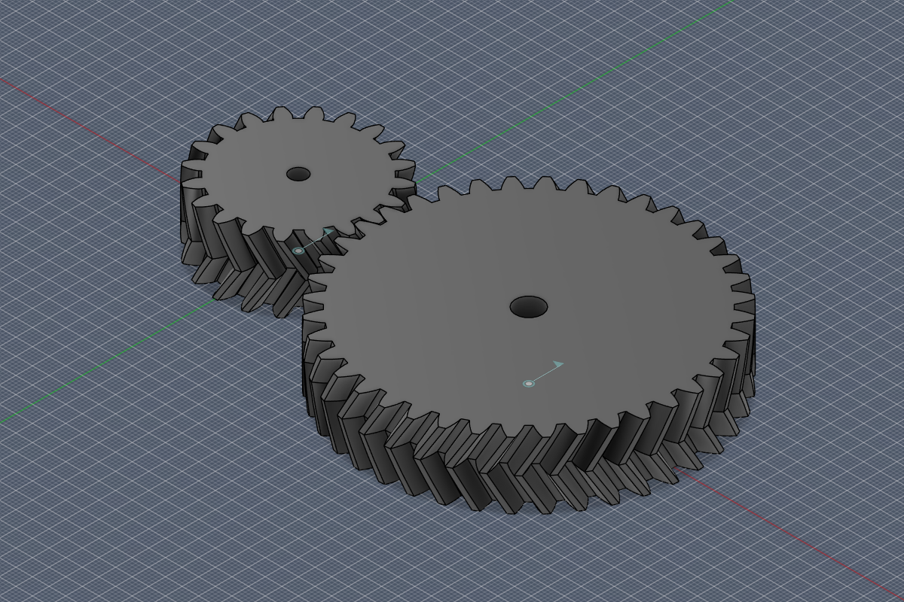
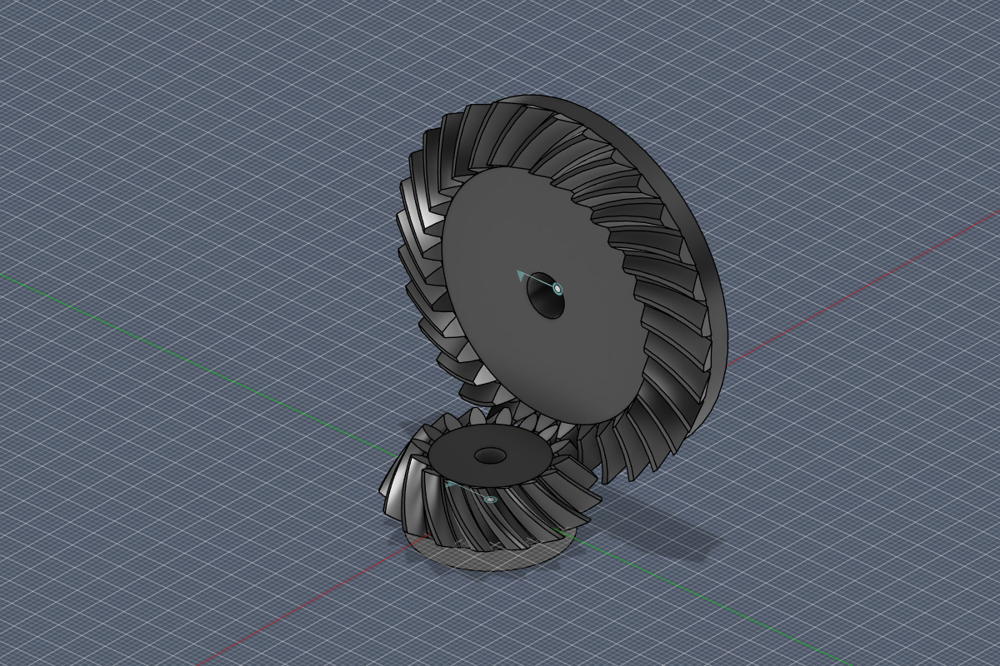
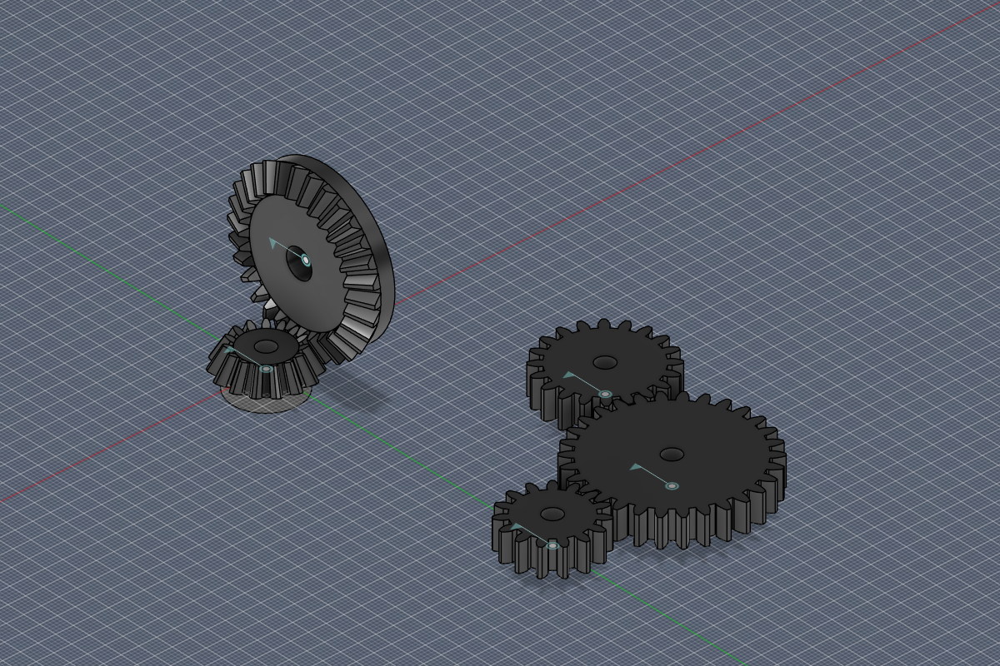

# FusionGears

**English** · [Русский](README.ru.md)

An Autodesk Fusion add-in that builds involute gears: **herringbone, helical and spur** gears, and **bevel gears with straight, skew, spiral or Gleason circular-arc teeth**. It can build the mating gear in mesh, add revolute joints and a motion link so the pair turns in Fusion, and check a whole gear train for mistakes. It also places standard **ball bearings** on the edge of a hole or shaft.

| Gleason circular-arc bevel pair 16:32 | Gear train and a bevel pair |
|---|---|
|  |  |

## Features

- **Herringbone / helical gear** (*Solid → Create*): herringbone, helical or spur teeth; normal module, helix angle and hand, pressure angle, face width, bore, backlash.
- **Bevel gear** (*Solid → Create*): straight, skew (tangential), spiral (logarithmic) or **Gleason circular-arc** teeth; any shaft angle, not only 90°; outer transverse module, spiral angle at mid-face, cutter radius for Gleason teeth, back thickness, bore, backlash. The dialog shows how the spiral angle changes from toe to heel.
- **Mating gear**: built in mesh — at the centre distance for cylindrical gears, with a common cone apex for bevel gears — with the opposite hand of teeth.
- **Mechanism**: revolute joints for both gears on a grounded frame and a motion link z1:z2. The add-in tests the direction of rotation by turning the pinion and checking that the teeth do not collide.
- **Typical sets**: 12 ready-made pairs (herringbone 1:2 for 3D printing, NEMA17 gearbox 1:3, bevel 1:1 … 1:3, Gleason 1:2, …) fill the dialog in one click.
- **Gear train check** (*Inspect*): finds contradictory motion links (a gear that would have to turn both ways, such as three gears meshing in a triangle), links that drive meshing teeth into each other, intersecting gears and gears in mesh with no link.
- **Bearing** (*Solid → Create*): deep groove ball bearings of the 6xx/MR, 618, 619, 60, 62 and 63 series and thrust ball bearings 511 and 512 (83 sizes), or a custom size; detailed (rings, balls, 2Z shields) or as one body. Pick the circular edge of a hole or shaft and the bearing goes in coaxially — into the hole or onto the shaft — with its size matched to the diameter and a rigid joint holding it on the part.
- **English and Russian** dialogs, chosen by Fusion's interface language; names of the created components, sketches, joints and links follow it too.
- **Live calculation** in the dialog: pitch, tip and root diameters, centre distance, cone angles; invalid parameters are explained instead of producing broken geometry.

## Installation

1. Download the repository (**Code → Download ZIP**) and unpack it. **Rename the folder to `FusionGears`**: Fusion requires the add-in folder to have the same name as `FusionGears.py`.
2. In Fusion open **Utilities → Add-Ins → Scripts and Add-Ins** (Shift+S).
3. On the **Add-Ins** tab press **+** and select the `FusionGears` folder.
4. Turn the add-in on (the switch or **Run**) and, if you like, tick **Run on Startup**.

The commands appear in **Solid → Create** and **Inspect**. Step-by-step usage is in the [user guide](docs/USER_GUIDE.en.md).

## How the geometry is built

- **Cylindrical gears**: the whole involute outline is swept along the axis with a twist, which gives an exact helix; a herringbone gear is one half plus a mirror.
- **Bevel gears**: tooth profiles follow Tredgold's back-cone approximation and taper towards the apex; one tooth is lofted through sections normal to the pitch cone, patterned and joined to the blank. Curved teeth turn each section by the angle of the tooth trace on the crown gear: a tangent line (skew), a logarithmic spiral or the circle of a face-milling cutter head (Gleason).
- Every gear goes into its own component and timeline group. In a Part design, which has no components, bodies go into the root component and no joints are made.

## Limitations

- Standard rack: addendum 1·m, clearance 0.25·m; no profile shift and no root fillet, so undercut at small tooth counts is not modelled.
- Gleason teeth reproduce the circular-arc tooth trace and the changing spiral angle, but the tooth profile is still Tredgold's involute, not the profile generated on a Gleason machine (no tooth taper variants, no crowning). That is fine for 3D printing and prototypes, not for production gear cutting.
- Bearing internals (ball size and count, raceways) are approximate and no cage is modelled; only the boundary dimensions d, D, B (H) follow ISO 15 / ISO 104.
- New gears are always built at the origin; place them with joints or the Move command.

## Repository layout

| Path | Contents |
|---|---|
| `FusionGears.py` | the add-in: commands, dialogs, building in Fusion, joints, gear train check |
| `gearmath.py` | gear geometry without Fusion (involute, bevel sections, mesh phase) |
| `gearcheck.py` | consistency of motion-link chains without Fusion |
| `bearingmath.py` | bearing catalogue and ring and ball sections without Fusion |
| `presets.py` | typical gear sets |
| `strings.py` | all texts in English and Russian |
| `demo/FusionGearsDemo` | Fusion script that opens a correct and a faulty gear train to try the check on |
| `tests/test_gearmath.py` | offline tests: `python tests/test_gearmath.py` |
| `tests/FusionGearsSmoke` | Fusion script that builds every variant and checks bodies and motion |
| `tests/FusionGearsDevBridge` | development-only add-in that runs test scripts inside Fusion |
| `tools/make_icons.py` | draws the toolbar icons |

Tested with Autodesk Fusion 2703.1.20 on Windows.

## License

[MIT](LICENSE)
