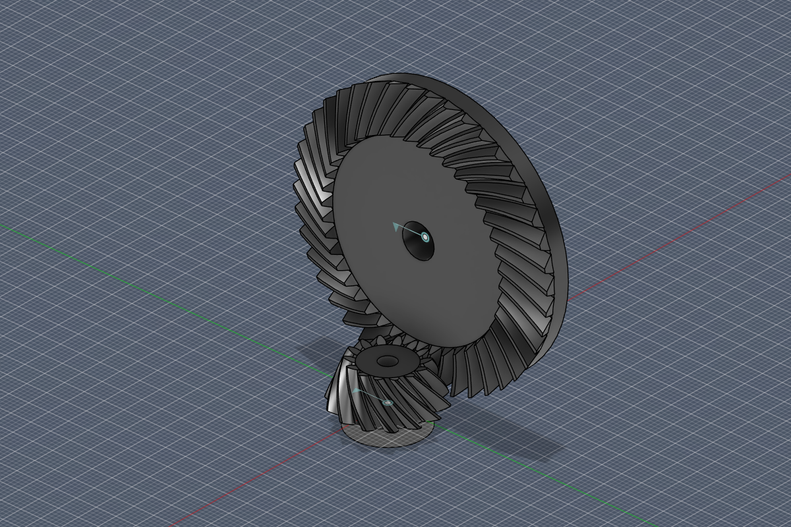

# FusionGears

[English](README.md) · **Русский**

Надстройка Autodesk Fusion для эвольвентных зубчатых колёс: **шевронных, косозубых и прямозубых**, а также **конических с прямым, косым и спиральным зубом**. Она строит сопряжённое колесо сразу в зацеплении, ставит вращательные соединения и связь движения, чтобы пара крутилась в Fusion, и проверяет всю зубчатую передачу на ошибки.

| Спиральная коническая пара 14:42 | Цепочка колёс и коническая пара |
|---|---|
|  |  |

## Возможности

- **Шевронная / косозубая шестерня** (*Solid → Create*): шевронный, косой или прямой зуб; нормальный модуль, угол наклона и направление зуба, угол профиля, ширина венца, отверстие, боковой зазор.
- **Коническая шестерня** (*Solid → Create*): прямой, косой (тангенциальный) или спиральный зуб; любой межосевой угол, не только 90°; внешний торцовый модуль, угол наклона в середине венца, толщина основания, отверстие, боковой зазор.
- **Сопряжённое колесо** строится сразу в зацеплении: у цилиндрических — на межосевом расстоянии, у конических — с общей вершиной конусов; направление зуба противоположное.
- **Механизм**: вращательные соединения обоих колёс со стойкой и связь движения z1:z2. Направление вращения надстройка проверяет сама: поворачивает шестерню и смотрит, чтобы зубья не врезались.
- **Типовые варианты**: 11 готовых пар (шеврон 1:2 для 3D-печати, редуктор 1:3 на NEMA17, угловые 1:1…1:3 и другие) заполняют окно одним выбором.
- **Проверка зубчатой передачи** (*Проверка / Inspect*): находит противоречивые связи (колесо должно крутиться сразу в обе стороны — например, три колеса «треугольником»), связи, при которых зубья врезаются, пересекающиеся колёса и колёса в зацеплении без связи.
- **Расчёт прямо в окне**: делительный диаметр, диаметры вершин и впадин, межосевое расстояние, углы конусов. Недопустимые параметры объясняются сообщением, а не битой геометрией.

## Установка

1. Скачайте репозиторий (**Code → Download ZIP**) и распакуйте. **Переименуйте папку в `FusionGears`**: Fusion требует, чтобы папка надстройки называлась так же, как `FusionGears.py`.
2. В Fusion откройте **Утилиты → Надстройки → Сценарии и надстройки** (Shift+S).
3. На вкладке **«Надстройки»** нажмите **+** и выберите папку `FusionGears`.
4. Включите надстройку переключателем (или кнопкой **«Запустить»**) и при желании отметьте **«Запускать при старте»**.

Команды появятся в **Solid → Create** и в панели **«Проверка»**. Пошаговая работа описана в [инструкции](docs/USER_GUIDE.ru.md).

## Как строится геометрия

- **Цилиндрические колёса**: полный эвольвентный контур протягивается вдоль оси с закруткой, поэтому винтовая линия точная; шевронное колесо — половина плюс зеркальная копия.
- **Конические колёса**: профиль зуба строится по Тредгольду (эквивалентное колесо на дополнительном конусе), зуб сужается к вершине; один зуб строится лофтом через сечения, перпендикулярные делительному конусу, затем размножается по кругу и объединяется с заготовкой.
- Каждое колесо — в своём компоненте и своей группе на таймлайне. В дизайне типа Part компонентов нет: тела строятся в корневом компоненте, а соединения не создаются.

## Ограничения

- Исходный контур стандартный: высота головки 1·m, радиальный зазор 0.25·m; без смещения и без галтели во впадине, поэтому подрезание при малом числе зубьев не моделируется.
- Спиральный конический зуб — спираль с постоянным углом (логарифмическая), а не круговой зуб Gleason. Для 3D-печати и макетов этого достаточно, для заводской нарезки — нет.
- Окна команд на русском языке.
- Новые колёса всегда строятся в начале координат; расставляйте их соединениями или командой «Переместить».

## Состав репозитория

| Путь | Что внутри |
|---|---|
| `FusionGears.py` | надстройка: команды, окна, построение в Fusion, соединения, проверка передачи |
| `gearmath.py` | геометрия колёс без Fusion (эвольвента, сечения конического зуба, фаза зацепления) |
| `gearcheck.py` | согласованность цепочек связей движения без Fusion |
| `presets.py` | типовые варианты |
| `demo/FusionGearsDemo` | скрипт Fusion: открывает исправную передачу и передачу с ошибками для проверки |
| `tests/test_gearmath.py` | офлайн-тесты: `python tests/test_gearmath.py` |
| `tests/FusionGearsSmoke` | скрипт Fusion: строит все варианты и проверяет тела и вращение |
| `tests/FusionGearsDevBridge` | надстройка только для разработки: выполняет тестовые скрипты внутри Fusion |
| `tools/make_icons.py` | рисует иконки кнопок |

Проверено в Autodesk Fusion 2703.1.20 под Windows.
